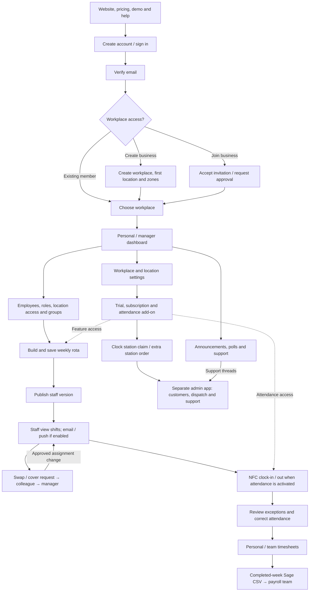
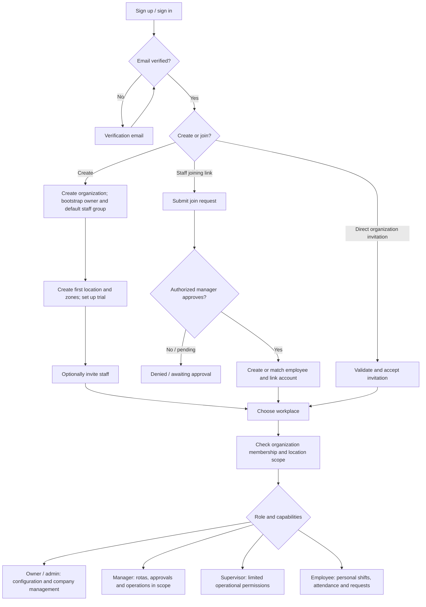
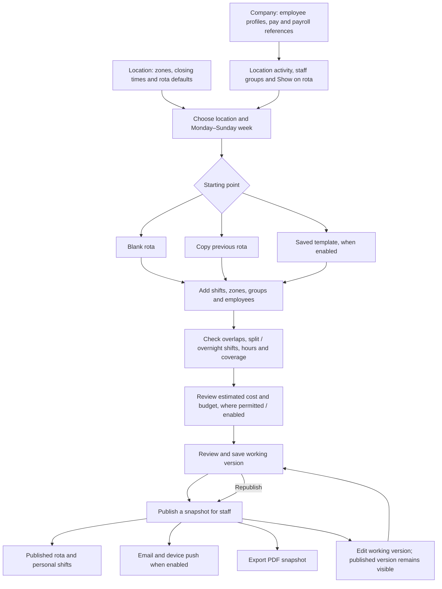
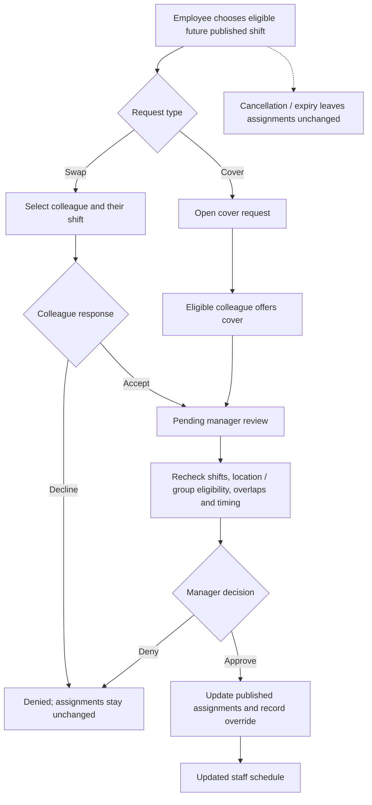
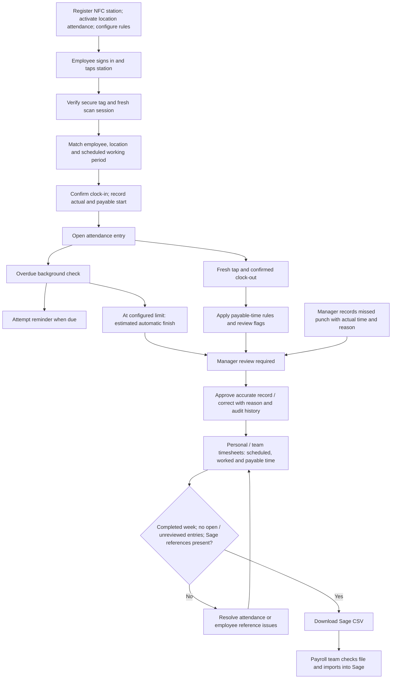
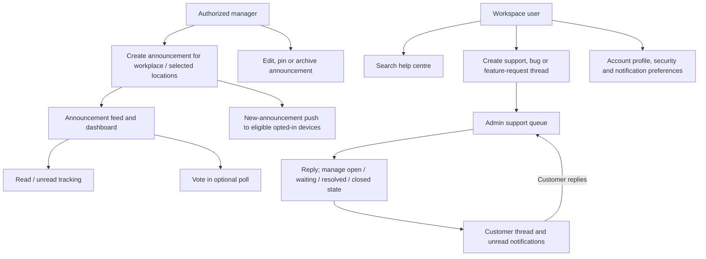
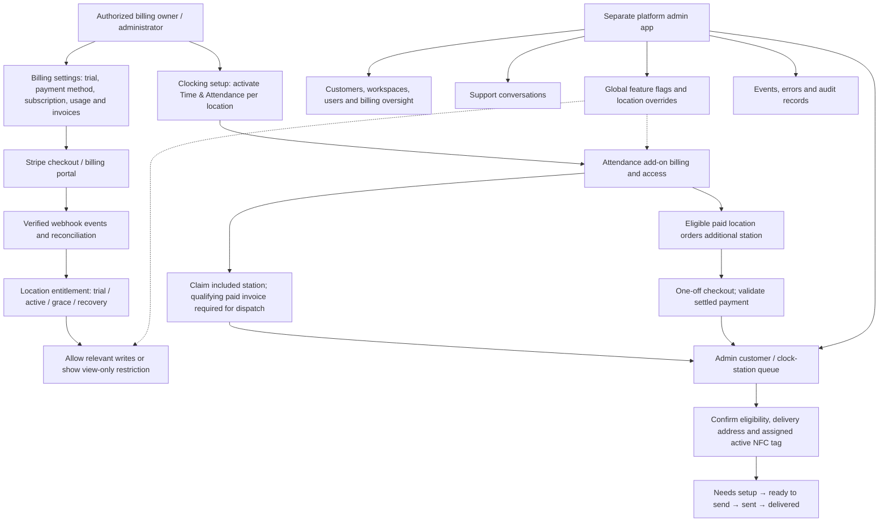
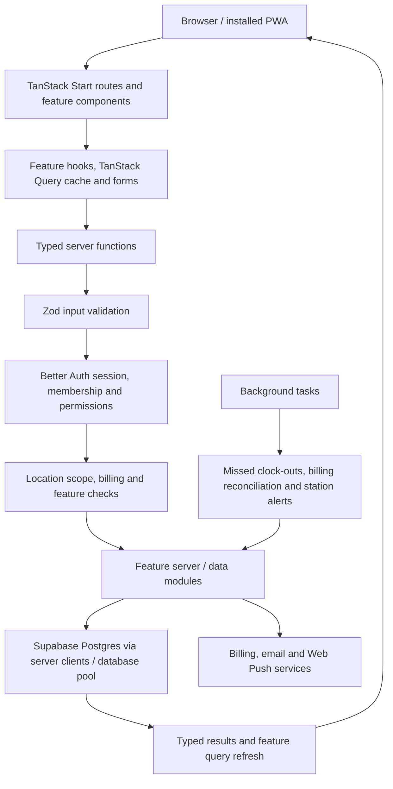

# RocketRota: how the app works

This map describes the workflows implemented in this checkout, reviewed on 26 October 2026. It is based on routes, feature modules, server actions and the in-app help guides; it does not certify the state of a deployed environment. Arrows show workflow or data dependencies, rather than every navigation link.

## 1. Whole-app overview

## 2. Accounts, joining and permissions

An account can belong to multiple workplaces. Role permissions, location access, staff groups and **Show on rota** have separate purposes. Joining a workplace does not assign shifts. Account settings cover profile, password, passkeys, sessions and preferences; device push and PWA installation support mobile use.

## 3. People and weekly rota planning

Saving and publishing are separate. Templates and copying reduce setup work; managers still confirm availability with staff. Approved swap overrides are reapplied when a rota is republished. Authorized users can also unpublish a rota or delete a draft. Employee removal revokes access and removes future assignments while retaining historical records; rehiring restores employee access with selected locations.

## 4. Shift swaps and cover

This workflow requires enabled workplace settings, relevant location feature access and user permissions. A peer's acceptance alone does not change the rota.

## 5. Clocking, attendance review and payroll export

The manager dashboard combines published staffing and attendance, with an attention queue for clock issues, unrecorded arrivals and swap requests. Acknowledging an arrival alert records a reason; it does not create attendance. Automatic clock-out proceeds independently of reminder delivery. Routine valid clock-outs can close directly; exceptional and automatic entries require review. Sage output is a file export; payroll processing remains outside RocketRota.

## 6. Communication, support and personal controls

Push delivery depends on user preferences and device subscriptions. Edits, pinning and poll activity do not trigger another new-announcement push. Support threads connect the customer app to the separate admin app.

## 7. Billing, hardware and platform administration

Feature availability combines billing entitlements, user permissions, workplace settings and platform feature flags. Enabling a flag does not grant a paid entitlement or permission. Station payment and eligibility checks precede dispatch; a checkout return page alone does not release hardware.

## 8. How the code supports these workflows

This is the principal application request path; authentication handlers, webhooks, background jobs and legacy paths have their own entry points. Server actions enforce access independently of visible UI controls.

## Scope and source references

The original product requirements include aspirations beyond the implemented app. Standalone leave / availability management, tracked breaks, automated scheduling, payroll processing and a live Sage sync are not represented here as shipped workflows.

- [Routes](../src/routes), [platform admin routes](../apps/admin/src/routes) and [feature modules](../src/features).
- [Role permissions](../src/lib/auth/permissions.ts), [onboarding actions](../src/features/onboarding/server/organization-actions.ts) and [join approvals](../src/features/join-approvals/server/actions.ts).
- [Rota publishing](../src/features/rota/server/update-actions.ts), [publish notifications](../src/features/rota/server/publish-notifications.ts) and [swap actions](../src/features/shift-swaps/server/actions.ts).
- [Clock actions](../src/features/time-clock/server/actions.ts), [timesheet actions](../src/features/timesheets/server/actions.ts), [manager dashboard](../src/features/dashboard/manager/README.md) and [automatic clock-outs](automatic-clock-out.md).
- [In-app help guides](../src/features/help-center/data), [feature flags](feature-flags.md) and [station fulfillment](customer-station-fulfillment.md).
